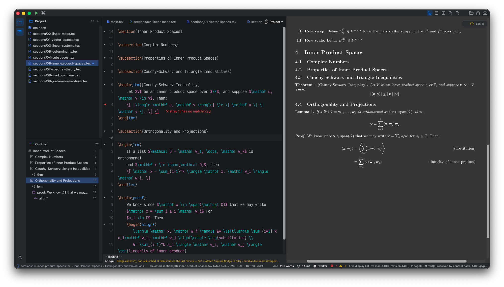

<p align="center">
  <a href="https://flash-tex.github.io/flashtex">
    <picture>
      <source media="(prefers-color-scheme: dark)" srcset="assets/brand/flashtex-logo-dark.svg">
      <source media="(prefers-color-scheme: light)" srcset="assets/brand/flashtex-logo.svg">
      
    </picture>
  </a>
</p>

<p align="center">
  <a href="https://flash-tex.github.io/flashtex">Website</a> ·
  <a href="https://flash-tex.github.io/flashtex/download">Download &amp; setup</a> ·
  <a href="https://discord.gg/J4kHDJmTrD">Discord</a>
</p>

FlashTeX is a blazing-fast (La)TeX engine written in Rust.
This project actually consists of two things:

- A faithful Rust port of pdfTeX (translated from `pdftex.web`, so its PDFs
  are pdflatex's, byte for byte), with incremental compilation on top: after
  a keystroke only the pages it changes are typeset again
  
- A native, lightweight, and snappy TeX IDE with live previews: a keystroke
  reaches its updated page in milliseconds (a median of 3–11 ms of engine
  time on 10- to 1,000-page articles on an M5 Pro, 12–20 ms on 1,000-page
  documents on a GitHub-hosted M1 VM; see [Benchmarks](#benchmarks)). It pairs with a companion iPad app
  (FlashTeXPad) for inline LaTeX/TiKZ OCR (diagrams included).
  A native Windows app lives under `apps/windows/` and is **work in progress, not stable**.



**An incremental pdfTeX-compatible engine with a command line, and a native
macOS IDE built on it.**

FlashTeX's engine is pdfTeX, ported to Rust: `flashtex-v3 build main.tex`
compiles as latexmk would (bibtex, biber and makeindex included) and writes
the PDF pdflatex writes, using your TeX Live 2026 for packages and fonts. The
engine runs as its own process, `flashtex-host`. It keeps the document's
state between compiles, so an edit re-typesets the pages it changes and the
preview gets the edited page in milliseconds. A Unicode mode
(`--mode unicode`, a port of XeTeX) does the same for fontspec documents. The
IDE, a Swift app for macOS, links nothing and drives the same host over a
documented socket protocol (display-list-v3): you type LaTeX and the page
re-renders as you type. An iPad companion (FlashTeXPad) turns Pencil
sketches and photos into reviewed LaTeX/TikZ insertions. The engine, the
editor and the companions are separate processes with versioned contracts,
so each can be replaced or scripted on its own.

The old engine's `flashtex` command, a hand-written LaTeX subset with its own
fonts and PDF writer, still ships. It is frozen (fixes only) and will be
retired; `flashtex-v3` is its successor. See
[The `flashtex` command line](docs/user/compiler.md).

## Features

- **The `flashtex-v3` CLI** — `build` (as latexmk would: bibtex, biber and
  makeindex when the document needs them; the PDF pdflatex writes), `check
  [--json]` (TeX's diagnostics as `file:line:col`), `watch` (one warm engine
  for the session) and `--mode unicode` for fontspec documents. It needs TeX
  Live 2026. The old engine's `flashtex` CLI (`build`, `check`, `watch`,
  `supported`, `fonts`, `worker`) still ships, frozen, until it is retired.
- **Workspace and multi-file projects** — a `.tex` file and its folder are the
  project; `\input`/`\include` targets appear in the sidebar with an outline of
  sections, environments and labels.
- **Editor** — LaTeX syntax highlighting, completion for commands, environments
  and labels (⌃Space), a command palette (⌘⇧P).
- **Per-keystroke incremental compile** — every edit is compiled by the bundled
  engine; only the paragraphs you touched are re-typeset.
- **Live preview** — an exact display list painted with Latin Modern glyphs,
  zoom (⌘= / ⌘- / fit width ⌘9 / actual size ⌘0), click-to-source, caret sync
  (⌘⇧J), dark preview.
- **Diagnostics** — errors, warnings and "not implemented" notes in a Problems
  panel (⌘⇧M) with go-to-source, grouped duplicates, explanations and quick
  fixes where one exists.
- **PDF export** — pdfTeX's own PDF output, ported with the engine, so the
  exported PDF is byte for byte pdflatex's apart from the document ID.
- **iPad companion** — pair FlashTeXPad over the local network, capture a
  sketch or photo, review the proposed LaTeX/TikZ on the Mac and insert it as
  one undoable edit.
- **Windows native app (WIP, not stable)** — a WinUI 3 IDE under
  `apps/windows/` that drives the same worker protocol. It is not a
  supported product yet; see [apps/windows/README.md](apps/windows/README.md).
- **Helper-process architecture** — engine, PDF writer, capture bridge, edit
  ledger and project index are separate Rust binaries with documented JSON
  Lines contracts, usable from any editor or script.

## Benchmarks

Measured on 2026-10-14 against main `a8379a52b` (release build, rustc 1.99.0). The oracle is TeX
Live 2026: pdfTeX 1.40.29, XeTeX 0.999998 and latexmk. pdflatex and xelatex never run inside the
product. They are only used for comparison. **Machines:** most tables come from a **GitHub-hosted
M1 VM (macos-15, 3 vCPU, 7 GB)**, a shared virtual machine. The T7 latency run used the owner's
**Apple M5 Pro**, which is **not** the P4 reference M1 Max, and that run is non-reference because
of load. Every table, the raw data and the exact commands are in
[`docs/evidence/bench-2026-10-14/`](docs/evidence/bench-2026-10-14/README.md). Medians and p95 come
from 7–9 runs.

### Live preview: a keystroke against a rebuild

The same document on the same machine (hosted M1 VM). The left column is a keystroke's time to its
updated page, typing through the engine host as the app does (Balanced mode). The others are a
cold rebuild of the whole document.

| document | keystroke → updated page, p50 / p95 | pdflatex, one pass | latexmk, full build | vs one pdflatex pass | vs a latexmk rebuild |
|---|---:|---:|---:|---:|---:|
| full-1000 (1,002 pages: math, TikZ, `siunitx`, `cleveref`) | **19.6 / 53.8 ms** | 12.1 s | 37.9 s | **617× faster** | **1,935× faster** |
| plain-1000 (1,001 pages of text) | **11.8 / 46.9 ms** | 2.40 s | 4.91 s | **203× faster** | **416× faster** |
| b04, Unicode mode (`fontspec`, 11 pages) | **11.2 / 17.0 ms** | xelatex 1.17 s | latexmk -xelatex 2.64 s | **104× faster** | **236× faster** |

On the M5 Pro, the T7 run (`scripts/t7-reference.sh`) measures the engine's share: from the edit
reaching the host to the edited page leaving it, p50 / p95. It has rows for each of these:

| document | pages | one letter | typing, a key every 100 ms | a sentence that reflows | a preamble edit (to page 1) |
|---|---:|---:|---:|---:|---:|
| plain-100 | 100 | 4.2 / 5.6 ms | 3.7 / 4.3 ms | 3.6 / 3.9 ms | 35 / 37 ms |
| full-100 | 101 | 6.9 / 7.9 ms | 6.0 / 6.6 ms | 6.8 / 8.5 ms | 169 / 193 ms |
| plain-1000 | 1,001 | 5.6 / 6.4 ms | 5.2 / 5.5 ms | 6.2 / 7.6 ms | 44 / 51 ms |
| full-1000 | 1,002 | 8.4 / 9.5 ms | 9.7 / 12.8 ms | 8.4 / 9.4 ms | 200 / 214 ms |
| beamer-30 | 58 | 24.4 / 26.3 ms | 23.8 / 26.5 ms | 24.0 / 26.9 ms | 267 / 304 ms |
| *Infinite Descent* (book) | 592 | 77 / 81 ms | 47 / 145 ms | 83 / 90 ms | not measured |

The verdict on all 120 gated rows was 89 pass and 31 miss the 11 ms target. Most misses are beamer
decks and full-1000's typing rows (p95 11.7–13.2 ms). The run is non-reference: load1 reached 7.3
with the owner's apps open. *Infinite Descent*'s rows come from that run's raw records: a harness
bug stopped its preamble phase, and this change fixes it. On that book, keys typed 60 ms apart queue
up (p50 969 ms); that is a finding for the incremental lanes.

### Cold compile: the engine against pdflatex and latexmk

Hosted M1 VM. Each run is a fresh copy of the document, with no `.aux`, and the times are p50 /
p95. **engine** is the new engine itself (`flashtex-initex`, run as pdflatex), for one pass and as
latexmk's pdflatex. **Output:** for all 11 documents, the engine's PDF is **byte-identical** to
pdflatex's, and `flashtex-v3 build`'s differs only in the trailer `/ID`, which hashes the output
file's name.

| document | pdflatex, one pass | engine, one pass | latexmk | latexmk with the engine | `flashtex-v3 build` |
|---|---:|---:|---:|---:|---:|
| `HW1.tex` (3 pages) | 657 ms | **208 ms (3.2×)** | 1.60 s | **663 ms (2.4×)** | 791 ms (2.0×) |
| `HW2.tex` (3 pages) | 539 ms | **162 ms (3.3×)** | 1.20 s | **536 ms (2.2×)** | 641 ms (1.9×) |
| plain-100 | 708 ms | **324 ms (2.2×)** | 1.52 s | **886 ms (1.7×)** | 2.24 s (0.68×) |
| full-100 | 2.00 s | **1.06 s (1.9×)** | 4.24 s | **3.68 s (1.2×)** | 5.08 s (0.83×) |
| beamer-30 | 2.87 s | **2.34 s (1.2×)** | 5.96 s | 7.25 s (0.82×) | 8.14 s (0.73×) |
| plain-1000 | 2.40 s | **1.81 s (1.3×)** | 4.91 s | **4.09 s (1.2×)** | 14.6 s (0.34×) |
| full-1000 | 12.10 s | **6.54 s (1.9×)** | 37.9 s | **19.8 s (1.9×)** | 53.0 s (0.72×) |
| *Infinite Descent* (592 pages) | 23.4 s | **19.4 s (1.2×)** | 71.9 s | **63.5 s (1.1×)** | 118.6 s (0.61×) † |
| *Infinite Descent* ×2 (1,142 pages) | 56.4 s | **47.9 s (1.2×)** | 162.8 s | **152.4 s (1.1×)** | 300.3 s (0.54×) † |

Medians. The factors in brackets are against pdflatex for one pass, and against latexmk otherwise.
The engine is faster than pdflatex on every document, by 1.2× to 3.3× per pass, and its latexmk
build is faster on 10 of the 11.

**Known issue: `flashtex-v3 build` is slower than latexmk on a cold build of anything over about
100 pages.** It is 0.34× on plain-1000 and 0.61× on *Infinite Descent*. It runs the live preview's
resident compile, which keeps checkpoints, before the export compile; a one-shot build does not need
those checkpoints. The lane CLI-COLD is fixing it. On both books it also exits 1 with
"makeindex: errors" (marked †), although the PDF it writes is pdflatex's.

**Overleaf** was not measured: it needs an account and compiles remotely. Overleaf runs pdflatex
through latexmk, so a full Overleaf compile takes at least the latexmk time above, plus upload and
queueing.

### Unicode mode against xelatex

Hosted M1 VM, `flashtex-v3 build --mode unicode` against xelatex, p50. The output is structurally
identical to xelatex's, by the M3 export gate's check (`tools/xetex-pdfparity/compare.py`). It found
0 differences on all four documents, and every glyph was within 0.051 bp of xelatex's position.

| document | xelatex, one pass | latexmk -xelatex | `flashtex-v3 build --mode unicode` | keystroke → updated page |
|---|---:|---:|---:|---:|
| b01 article | 954 ms | 1.50 s | **608 ms (2.5×)** | 8.9 ms |
| b02 Georgia | 1.19 s | 1.92 s | **1.21 s (1.6×)** | 6.4 ms |
| b03 `unicode-math` | 1.71 s | 3.05 s | **2.98 s (1.0×)** | 16.4 ms |
| b04 `fontspec`, 11 pages | 1.17 s | 2.64 s | **1.86 s (1.4×)** | 11.2 ms |

The factors are against latexmk -xelatex.

### Opening a document, and memory

Opening in the app (hosted M1 VM, p50) takes 122 ms to the first page for `HW1.tex`, 62 ms for
plain-1000 and 1.9 s for *Infinite Descent*. The rest of the pages stream in after it: all of
*Infinite Descent* in 78 s. A **reopen** from the persisted state (S₀) and the last `.aux` takes a
single pass, so it shows *Infinite Descent*'s first page in 1.7 s and every page in 38 s.

The engine host's peak resident memory while typing:

| document | low-memory | Balanced (default) | high-performance |
|---|---:|---:|---:|
| plain-1000 | 485 MB | 569 MB | 658 MB |
| full-1000 | 543 MB | 667 MB | 832 MB |
| *Infinite Descent* ×2 | 445 MB | 1.12 GB | 1.50 GB |

On the M5 Pro the T7 run's Balanced host peaked at 154 MB on a 10-page article, 189–232 MB at 100
pages and 541–655 MB at 1,000 pages. One pass of pdflatex peaks at 47–82 MB.

<details>
<summary>Exact commands</summary>

```sh
# Hosted (GitHub's macos-15 runners): .github/workflows/bench-readme.yml, every shard
gh workflow run bench-readme.yml -f ref=<sha>
# What its shards run, after cargo build --release, MacTeX 2026 and
# tools/incr-bench/mkeng.sh ref && python3 tools/incr-bench/mkdocs.py && python3 tools/incr-bench/mkbook.py infdesc infdesc-x2:
python3 tools/incr-bench/bench_readme.py OUT.jsonl --docs hw1,hw2,plain-100,full-100,beamer-30,plain-1000,full-1000,infdesc,infdesc-x2 --reps 7
python3 tools/incr-bench/bench_readme.py OUT.jsonl --set unicode --reps 9
python3 tools/incr-bench/unicode.py target/release/flashtex-host-unicode tools/incr-bench/unicode-corpus/b04-fontspec-11pages.tex --keys 40
python3 tools/incr-bench/coldopen.py /tmp/ib/ref DOCDIR main.tex open.jsonl --reps 7
python3 tools/incr-bench/coldopen.py /tmp/ib/ref DOCDIR main.tex reopen.jsonl --reps 8 --keep-aux --keep-s0
MODES_INFDESC=/tmp/ib/docs/infdesc-x2 MODES_LIMIT_GB=6 tools/incr-bench/modes.sh ref
python3 tools/incr-bench/bench_readme_table.py cold OUT.jsonl            # the tables

# M5 Pro, on mains power with Low Power Mode off: T7
scripts/t7-reference.sh --no-build --max-load 4 --wait 300 --out DIR \
  --docs plain-10,full-10,plain-100,full-100,plain-300,full-300,plain-1000,full-1000,beamer-5,beamer-30,infdesc
```

</details>

## Installation

FlashTeX is a LaTeX engine with a command line plus native GUIs built on
it, and they install separately. The Mac app is the supported GUI. The
Windows app is a work in progress and is **not stable**.

### A. Engine + CLI (macOS or Linux)

Each release ships `flashtex-cli-<version>-<platform>.tar.gz`: macOS arm64
always, Linux x86_64 best-effort (see [CI/CD](docs/ci-cd.md)). The tarball has
`bin/flashtex` plus the `flashtex-render`, `flashtex-compiler`,
`flashtex-pdf` and `flashtex-pdf-exact` helpers, with the fonts and metrics
they need in `share/flashtex/`.

```sh
curl -fsSL https://flash-tex.github.io/flashtex/install-cli.sh | sh
```

Detects your OS/CPU, verifies the download against the release's
`SHA256SUMS` (refuses on a mismatch), and installs into `~/.local/bin` +
`~/.local/share/flashtex` — pass `--prefix /usr/local` for a system install,
`--version vX.Y.Z` for another release, or `--uninstall` to remove it. Or
extract the tarball yourself and run `bin/flashtex build main.tex` directly;
`bin/flashtex install-cli` links it into `/usr/local/bin`.

### B. Engine + native GUI (macOS only, for now)

Requirements: **macOS 14 Sonoma or later on Apple Silicon** (arm64). No TeX
installation needed — the app bundles the engine, Latin Modern fonts and TeX
metrics, plus this same CLI at `Contents/MacOS/flashtex-cli`.

```sh
curl -fsSL https://flash-tex.github.io/flashtex/install.sh | sh
```

Downloads the pinned release DMG, verifies its SHA-256, installs into
`/Applications` (or `~/Applications`) and strips the quarantine flag. Or
download `FlashTeX.dmg` from
[Releases](https://github.com/flash-tex/flashtex/releases) and drag FlashTeX
into Applications yourself — the app is ad-hoc signed, not notarized, so the
first time: **right-click → Open** and confirm.

### C. Native GUI (Windows) — work in progress, not stable

There is no installer and no release yet. `apps/windows/` is a WinUI 3
shell that talks to the same `flashtex worker` protocol as the Mac app.
Expect missing features, preview mismatches, and breaking changes. Build
instructions and an honest status list are in
[apps/windows/README.md](apps/windows/README.md).

The CLI already runs anywhere it is built for, and any editor or CI can
drive the engine over the documented JSON Lines `worker` protocol
(see [Extending FlashTeX](docs/extensibility.md)).

**From source** (either path; Xcode Command Line Tools with Swift 6, stable
Rust from rustup — there is no root Cargo workspace, each crate builds on its
own):

```sh
git clone https://github.com/flash-tex/flashtex.git && cd flashtex
cargo build --release --manifest-path crates/flashtex-cli/Cargo.toml   # A: the engine + CLI
scripts/ci/build-helpers.sh                 # release-builds the CLI and every helper crate
apps/mac/scripts/make-app.sh --install      # B: packages FlashTeX.app into ~/Applications
apps/mac/scripts/make-app.sh --dmg          # or: build a disk image
```

Full details: [Getting started](docs/user/README.md) and
[Building from source](docs/user/compiler.md#building-from-source).

## Quick start — CLI

```sh
flashtex-v3 build main.tex                 # main.pdf next to it: the PDF pdflatex writes (bibtex/makeindex run as needed)
flashtex-v3 build main.tex --mode unicode  # Unicode mode (XeTeX): fontspec, unicode-math, system fonts
flashtex-v3 check main.tex --json          # TeX's diagnostics; exit 1 on an error
flashtex-v3 watch main.tex                 # rebuild on every change, one warm engine; Ctrl-C stops
```

The old engine's CLI, frozen until it is retired:

```sh
flashtex build main.tex                       # main.pdf next to it; \input/\include resolved from its folder
flashtex build main.tex -o out.pdf --timing   # exact-route PDF; render / pdf / total on stderr
flashtex check main.tex --json                # diagnostics only, flashtex-check/1 on stdout
flashtex watch main.tex                       # rebuild on every change in the project; Ctrl-C stops
flashtex supported                            # implemented LaTeX + coverage (--json, --md)
flashtex fonts                                # which fonts and TeX metrics this binary resolves
```

Diagnostics are `file:line:col: severity[code] message` lines on stderr with
a summary line; exit `0` when the document rendered (`ok`, or `recovered`
with diagnostics — `--strict` makes recovered errors exit `1`), `1` when it
`failed`, `2` for a usage error. The app bundle and the tarball find their
fonts next to the binary; a source build adds `--font-dir apps/mac/Fonts`.
`flashtex worker` is the long-running JSON Lines worker the IDE drives (one
`compile` request per stdin line, one `compile_result` per stdout line), so
any editor or CI can embed the engine. Every flag, the JSON schema, the font
search order and the helper binaries are documented in
[The `flashtex` command line](docs/user/compiler.md).

## Quick start — IDE

1. **Open FlashTeX**, then *File › Open LaTeX File…* (⌘O) — or type into the
   sample buffer and ⌘⇧S to save it. The file becomes the entry document and
   its folder the project root; the bundled engine attaches automatically.
2. **Type.** Auto-compile is on (⌘B compiles on demand); zoom the preview with
   ⌘= / ⌘-, click any word to jump to its source, open **Problems** (⌘⇧M) to
   see and fix diagnostics.
3. **Export** with *File › Export PDF…* (⌘⇧E); **pair an iPad** with
   *Edit › Nearby Companion…* (⌘⇧N) → Advertise → Show Pairing Code, then scan
   the code from FlashTeXPad.

Everything else — projects, IntelliSense, capture conversion, preferences and
the full shortcut table — is in [The Mac app](docs/user/gui.md); the
companion is in [FlashTeXPad for iPad](docs/user/ipad.md).

## Architecture

The engine is a library (`crates/render-pipeline`) with one front end,
`flashtex` (`crates/flashtex-cli`). The Mac app never links it: it launches
`flashtex worker` (or the bare `flashtex-render`) and talks to it over
stdin/stdout with versioned JSON Lines contracts
([runtime-v1](docs/contracts/runtime-v1.md), the rendering-v2 display list in
[`protocol/`](protocol/)); a crashed helper is relaunched and the last good
preview stays on screen. The same contracts make the engine usable from other
editors and CI.

```
crates/
  flashtex-cli/      the `flashtex` command line: build / check / watch / supported / worker / fonts
  compiler/          lexer, LaTeX subset, runtime-v1 JSON Lines worker (flashtex-compiler)
  render-pipeline/   the engine: parse tree → styled blocks → shaping → Knuth-Plass →
                     Appendix G math → pages → display list (flashtex-render)
  font-engine/, font-resources/, math-layout/, paragraph-layout/, document-style/, …
  pdf/               PDF writer (flashtex-pdf, flashtex-pdf-exact)
  bridge/            iPad capture receipt, conversion, reviewed edits (flashtex-bridge)
  project-files/, edit-ledger/, project-index/, preview-controller/, …
apps/mac/            the SwiftUI/AppKit IDE, bundled fonts and TeX metrics, packaging scripts
apps/windows/        native WinUI 3 IDE (work in progress, not stable)
apps/ios/            FlashTeXPad, the iPad capture companion
protocol/            rendering-v2 schema and wire fixtures
fixtures/            real-world documents with pdfLaTeX reference PDFs
docs/                user guides, contracts, evidence reports
```

## Community

Questions, feedback and release news: the FlashTeX Discord — <https://discord.gg/J4kHDJmTrD>.

## Contributing

Issues and pull requests: <https://github.com/flash-tex/flashtex>. CI builds
and tests every crate, the Mac app and the iPad companion on each push; tagging
`vX.Y.Z` builds the DMG and CLI tarballs and publishes a release — see
[CI/CD](docs/ci-cd.md). Agents (Claude Code, Codex, Cursor) working in this
repository must follow [AGENTS.md](AGENTS.md); the onboarding notes are in
[docs/agents/README.md](docs/agents/README.md).

## License

[MIT](LICENSE) © 2026 flash-tex. The bundled Latin Modern and New Computer
Modern fonts are under the [GUST Font License](apps/mac/Fonts/GUST-FONT-LICENSE.TXT)
(see [apps/mac/Fonts/README.md](apps/mac/Fonts/README.md)).
